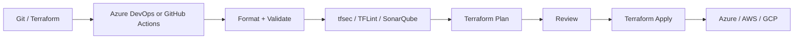

<!--
  KRISHNA SHARMA / GitHub Profile
  Crafted for the profile repository: krishnasharma-cloudops/krishnasharma-cloudops
  Theme: midnight / electric teal. Designed to feel like an engineering portfolio, not a badge wall.
-->

  

 

## `01` / THE ENGINEER

**I build cloud infrastructure as code, automate delivery, and put security into the workflow—not at the end of it.**

I'm **Krishna Sharma**, a DevOps & DevSecOps professional with **15 months of internship experience** across cloud infrastructure automation, CI/CD, security validation, and multi-cloud environments. **Terraform is my strongest skill**: modular IaC, remote state, locking, backends, workspaces, and resource lifecycle management.

I work primarily with **Microsoft Azure**, alongside **AWS and GCP**. I also use **Google Antigravity and AI agents** for AI-assisted Terraform development, infrastructure troubleshooting, and pipeline debugging.

> **Engineering approach:** Repeatable infrastructure · Verifiable changes · Security by design · Practical AI assistance

## `02` / TECHNOLOGY DNA

**CLOUD & INFRASTRUCTURE**

**DELIVERY & AUTOMATION**

**LANGUAGES & SYSTEMS**

| Discipline | Tools & engineering practices |
| :--- | :--- |
| **Infrastructure as Code** | Terraform, HCL, reusable modules, remote state, state locking, workspaces |
| **Azure architecture** | Landing Zones, Hub-and-Spoke networks, VNets, NSGs, RBAC, Key Vault |
| **Delivery** | Azure DevOps, YAML pipelines, GitHub Actions, Git |
| **DevSecOps** | tfsec, TFLint, SonarQube, shift-left checks |
| **AI-assisted workflows** | Google Antigravity, AI agents, IaC generation, troubleshooting |
| **FinOps** | Infracost, OpenCost, infrastructure cost visibility |
| **Foundations** | Linux CLI, Python, Java, C++, Bash, PowerShell *(basic)* |

## `03` / SELECTED BUILDS

<table>
<tr>
<td width="50%" valign="top">
<h3>01 — Azure Landing Zone</h3>

<b>Architecture / Terraform / Azure</b>

Implemented Azure Landing Zone infrastructure and a Hub-and-Spoke network architecture using modular Terraform configurations.

<code>Azure</code> <code>Terraform</code> <code>Networking</code>

</td>
<td width="50%" valign="top">
<h3>02 — Multi-Cloud IaC</h3>

<b>Provisioning / Reusability / State</b>

Provisioned infrastructure across Azure, AWS and GCP using Terraform modules, remote backends, state locking, and multi-environment configurations.

<code>Azure</code> <code>AWS</code> <code>GCP</code> <code>HCL</code>

</td>
</tr>
<tr>
<td width="50%" valign="top">
<h3>03 — Secure Terraform Delivery</h3>

<b>CI/CD / DevSecOps / Quality gates</b>

Built YAML-based infrastructure delivery workflows with Azure DevOps and GitHub Actions; incorporated tfsec, TFLint and SonarQube checks.

<code>Azure DevOps</code> <code>GitHub Actions</code> <code>tfsec</code>

</td>
<td width="50%" valign="top">
<h3>04 — AI-Assisted DevOps</h3>

<b>AI agents / Terraform / Debugging</b>

Used Google Antigravity and AI agents to assist with Terraform code generation, configuration refinement, task execution and CI/CD troubleshooting.

<code>Antigravity</code> <code>AI Agents</code> <code>Terraform</code>

</td>
</tr>
</table>

**Also explored:** **Infracost** for Terraform cost estimates and **OpenCost** for cloud-native infrastructure cost visibility.

<b>View the infrastructure delivery reference flow</b>

 

A conceptual delivery pattern featuring tools used in my projects; not a claim that every step was deployed in one pipeline.

## `04` / EXPERIENCE

| Role | Organization | Period |
| :--- | :--- | :--- |
| **DevOps Intern** | Davin Technologies | Jul 2026 – Oct 2026 |
| **DevOps & DevSecOps Intern** | DevOps Insider | Jun 2025 – Jun 2026 |

**Work covered:** Terraform-based automation, multi-cloud provisioning, Azure architecture, YAML CI/CD pipelines, security analysis, cost visibility, and AI-assisted DevOps workflows.

## `05` / WHAT I'M BUILDING TOWARD

- **Infrastructure that scales:** modular Terraform and repeatable multi-environment deployments.
- **Delivery that is safer:** validation, security checks, and reviewable infrastructure changes.
- **AI used responsibly:** agent-assisted workflows with human review and technical verification.

---

### LET'S BUILD SOMETHING RELIABLE.

**DevOps · DevSecOps · Terraform · Multi-Cloud · AI-Assisted Automation**

<a href="mailto:krishna.sharma.cloud.ops@gmail.com">Email</a> &nbsp;·&nbsp; <a href="https://www.linkedin.com/in/krishna-sharma-42110229a/">LinkedIn</a> &nbsp;·&nbsp; <a href="https://github.com/krishnasharma-cloudops?tab=repositories">Repositories</a>

Design → Automate → Validate → Secure → Deliver

<!--
OPTIONAL CONTRIBUTION SNAKE: To enable, first run .github/workflows/snake.yml successfully,
then paste the <picture> snippet from SNAKE_SETUP.md here.
-->
